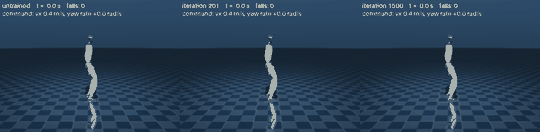

# tt_rsl_rl — rsl_rl training on Tenstorrent Blackhole (TTNN)

This repository ports the **training side of [rsl_rl](https://github.com/leggedrobotics/rsl_rl)** (rollout policy
inference + PPO update) to Tenstorrent Blackhole using TTNN, as a plugin package (`rsl_rl_tt/`) that is injected into the
**unmodified** upstream `OnPolicyRunner` through its configuration. Environments (simulators) stay where they are.

- **Based on:** [leggedrobotics/rsl_rl](https://github.com/leggedrobotics/rsl_rl) (BSD-3-Clause; upstream `LICENSE` retained).
  Full upstream history is preserved; remote `upstream` points to the original repository.
- **Baseline tag:** `v5.5.2` — everything under `rsl_rl/` is exactly this tag (checked by a test); the TT implementation
  lives in `rsl_rl_tt/`. *(The tag is provisional until it is confirmed against the Isaac Lab version in use.)*
- **Status / log:** [`docs/porting/PROGRESS.md`](docs/porting/PROGRESS.md) · work order:
  [`docs/porting/BRIEF.md`](docs/porting/BRIEF.md) · decisions: [`docs/porting/DECISIONS.md`](docs/porting/DECISIONS.md)
- **Docs:** [`docs/porting/`](docs/porting/) (environment, upstream map & semantics, tolerances, perf, TTNN issues)

| Phase | Scope | Status |
|-------|-------|--------|
| 0 | Environment, safety net, research, ADRs, device smoke + noise floors | done (tag `phase-0-done`) |
| 1 | Reference + parity harness (host only) | done (tag `phase-1-done`) |
| 2 | 1-chip (1x1 mesh) forward | done (tag `phase-2-done`) |
| 3 | 1-chip backward, optimizer, PPO update | done (tag `phase-3-done`) |
| 4 | 1-chip end-to-end training + checkpoint compatibility | done (tag `phase-4-done`) |
| 5 | 1-chip performance (trace, pre-allocation) | done (tag `phase-5-done`): 7-19x faster than upstream CPU per iteration, [`PERF.md`](docs/porting/PERF.md) |
| 6 | Tray multi-chip data parallel (8 chips) | done (tag `phase-6-done`): 1x2 and 2x4, 5.3x at 65536 envs on 8 chips, [`PERF.md`](docs/porting/PERF.md) 7b |
| 7 | Isaac Lab integration | done on the TT host (tag `phase-7-done`): env bridge, scripts, [`ISAAC_RUNBOOK.md`](docs/porting/ISAAC_RUNBOOK.md); the Isaac Lab side is unverified (no GPU host) |
| 8.1 | Post-v1: `HeteroscedasticGaussianDistribution` (state-dependent std) on the device | done (tag `phase-8-1-done`): 1 chip, 1x2, 2x4; order of the further items (RND, symmetry, distillation, RNN, CNN, SAC) in [`POST_V1.md`](docs/porting/POST_V1.md) |
| 8.2 | Post-v1: Random Network Distillation (`rnd_cfg`: intrinsic reward, predictor / target on the device) | done (tag `phase-8-2-done`): 1 chip, 1x2, 2x4; +31 % per iteration |
| 8.3 | Post-v1: symmetry (`symmetry_cfg`: data augmentation and mirror loss for affine mirror functions) | done (tag `phase-8-3-done`): 1 chip, 1x2, 2x4; +38 % per iteration with 2 copies |
| 8.4 | Post-v1: distillation (`Distillation`: a student MLP imitates a teacher; behaviour cloning on the device) | done (tag `phase-8-4-done`): 1 chip, 1x2, 2x4; 1.7-2.4x faster than upstream CPU end to end |

> This is a work in progress on shared hardware; it only ever touches one dedicated 8-chip tray (see `CLAUDE.md`).

**Examples:** [`examples/`](examples/README.md) — [`g1_walk/`](examples/g1_walk/README.md): train a Unitree G1 to walk (`train.py`, MuJoCo on the CPU, PPO on the tray) and replay / record it (`play.py`).

## Demo: a Unitree G1 learns to walk on command, trained on all eight chips

[](docs/porting/demo_g1/g1.mp4)

Left to right: **initial** (untrained: falls after 1.6 s, again and again), **middle** (iteration 101: keeps its balance, does not move yet), **final** (iteration 1500: follows the commands 0.4 m/s, 0.8 m/s, turning) —
the same commands for all three; under each robot its reward (return of the current episode, live), at the bottom the velocity tracking error, the critic's value loss and the reward terms (rewards and penalties, per second) against the training iteration, with the three iterations marked. **[Video (MP4, 20 s, real time)](docs/porting/demo_g1/g1.mp4)** · [slow-motion close-up of the gait](docs/porting/demo_g1/gait.mp4) · [**example to run yourself: `examples/g1_walk/`**](examples/g1_walk/README.md) ·
[details, numbers and how to reproduce](docs/porting/demo_g1/README.md). The G1 model of MuJoCo Menagerie, 4096 robots simulated on the CPU, PPO on the whole 2x4 tray: 1500
iterations (147 M samples, 28 min) take it from falling after 1.6 s to following velocity commands (0.4 / 0.8 m/s, turning) without a fall (0.39 / 0.78 m/s achieved). The training part of an iteration takes 0.27 s on eight
chips against 3.05 s for upstream PPO on the CPU; the CPU simulation (76 % of the time) is the bottleneck now. Simulation only, one seed.

---

# Original rsl_rl README (upstream, unchanged)

# RSL-RL

**RSL-RL** is a GPU-accelerated, lightweight learning library for robotics research. Its compact design allows
researchers to prototype and test new ideas without the overhead of modifying large, complex libraries. RSL-RL can also
be used out-of-the-box by installing it via [PyPI](https://pypi.org/project/rsl-rl-lib/), supports multi-GPU training,
and features common algorithms for robot learning.

> Additional algorithms, models, and more, mainly contributed by the community, can be found on the
> [`extras`](https://github.com/leggedrobotics/rsl_rl/tree/extras) branch. This allows us to keep the core library on
> `main` minimal and easy to start with. To see a list of the additional features, please check the
> [Extras Documentation](https://leggedrobotics.github.io/rsl_rl/extras/).

## Key Features

- **Minimal, readable codebase** with clear extension points for rapid prototyping.
- **Robotics-first methods** including PPO and Student-Teacher Distillation.
- **High-throughput training** with native Multi-GPU support.
- **Proven performance** in numerous research publications.

## Learning Environments

RSL-RL is currently used by the following robot learning libraries:

- [Isaac Lab](https://github.com/isaac-sim/IsaacLab) (built on top of NVIDIA Isaac Sim)
- [Legged Gym](https://github.com/leggedrobotics/legged_gym) (built on top of NVIDIA Isaac Gym)
- [mjlab](https://github.com/mujocolab/mjlab) (built on top of MuJoCo Warp)
- [MuJoCo Playground](https://github.com/google-deepmind/mujoco_playground) (built on top of MuJoCo MJX and Warp)

## Installation

Before installing RSL-RL, ensure that Python `3.9+` is available. It is recommended to install the library in a virtual
environment (e.g. using `venv` or `conda`), which is often already created by the used environment library (e.g.
Isaac Lab). If so, make sure to activate it before installing RSL-RL.

### Installing RSL-RL as a dependency

```bash
pip install rsl-rl-lib
```

### Installing RSL-RL for development

```bash
git clone https://github.com/leggedrobotics/rsl_rl
cd rsl_rl
pip install -e .
```

## Citation

If you use RSL-RL in your research, please cite the [paper](https://arxiv.org/abs/2509.10771):

```text
@article{schwarke2025rslrl,
  title={RSL-RL: A Learning Library for Robotics Research},
  author={Schwarke, Clemens and Mittal, Mayank and Rudin, Nikita and Hoeller, David and Hutter, Marco},
  journal={arXiv preprint arXiv:2509.10771},
  year={2025}
}
```
