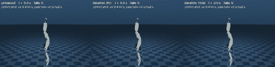
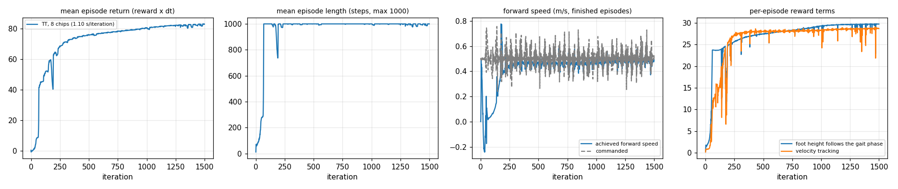

# Demo: a Unitree G1 learns to walk on command — physics on the CPU, training on all eight chips of the tray



**Video (20 s, real time, 1440x352 H.264, 1.8 MB): [`g1.mp4`](g1.mp4)** — three policies side by side following the same commands (0.4 m/s, 0.8 m/s, then 0.5 m/s while turning left, then right). Left: untrained
(falls forward after ~80 steps = 1.6 s, again and again). Middle: after 201 iterations. Right: after 1500 iterations.

The robot is the Unitree G1 (MJX variant of the model in [MuJoCo Menagerie](https://github.com/google-deepmind/mujoco_menagerie/tree/main/unitree_g1), BSD-3-Clause, (c) Unitree Robotics; fetched, not committed:
`scripts/fetch_g1_model.sh`). 4096 robots are simulated by MuJoCo on the CPU; the policy (actor + critic MLPs [512, 256, 128]) is trained by PPO on **all eight chips** of the tray (a 2x4 mesh, data parallel:
gradients averaged over the chips, replicas of the parameters checked every 10 updates and never found different) through the unmodified upstream `OnPolicyRunner` and `rsl_rl_tt.ppo:TTPPO`.

## Result (seed 0, one run)

1500 iterations x 4096 robots x 24 steps = **147 million samples in 27.6 minutes**. Deterministic evaluation of the checkpoints (256 robots x 600 control steps = 12 s each, a held command; `eval.json`):

| command (vx m/s, yaw rate rad/s) | untrained | iteration 201 | iteration 1500 |
|---|---|---|---|
| 0.4, 0 | 100 % fell (~80 steps) | 0.37 m/s, 0 falls | **0.39 m/s**, 0 falls |
| 0.8, 0 | 100 % fell | 0.76 m/s, 0 falls | **0.78 m/s**, 0 falls |
| 0.5, +0.4 | 100 % fell | 0.46 m/s, 0.32 rad/s, 0 falls | **0.51 m/s, 0.38 rad/s**, 0 falls |

(The speed of the untrained robots is not given: it is the speed of a robot falling forward.) The mean episode length is the maximum (1000 steps = 20 s) from iteration ~70 on, and
the speed follows the commanded speed from iteration ~250 on (`curves.png`; `tt_8chips/metrics.csv`, `summary.json`).



### Time: what the eight chips bring here

Per iteration (4096 robots, 98 304 samples), measured on the same task:

| | iteration | CPU simulation | the algorithm (act, GAE, PPO update) |
|---|---:|---:|---:|
| upstream PPO on the CPU (8 iterations) | 3.93 s | 0.88 s | 3.05 s |
| TT, one chip (60 iterations) | 1.35 s | 0.83 s | 0.51 s |
| **TT, eight chips (the 1500-iteration run)** | **1.10 s** | 0.84 s | **0.27 s** |

* The training part is 11.5x faster than on the CPU with eight chips (6x with one), and 1.9x faster than on one chip.
* The whole iteration is only 1.2x faster than with one chip, because **the CPU simulation is 76 % of the run** (1259 of 1656 s) and does not shrink with the chips. With a larger batch the chips would help more
  (with 65536 environments the whole iteration of the Phase 6 benchmark, which has no simulator, is 5x faster on eight chips), but the simulator would then take correspondingly longer. To go faster the physics has to move to faster hardware (a GPU simulator
  through the environment bridge of Phase 7, `ISAAC_RUNBOOK.md`) or onto more CPU cores.

## What this is and is not

* **One seed, one run**; a demonstration, not a benchmark. Simulation only: no domain randomisation, no pushes, no observation noise, so this policy would not run on the real robot as it is.
* **The task is written for this demo** (`rsl_rl_tt/demos/mujoco_g1.py` documents every term): velocity-command following on flat ground. The policy controls the 12 leg joints (position targets around the
  `knees_bent` pose, scale 0.25); the waist and arms are held at the keyframe pose by their PD actuators. Rewards: velocity tracking, upright posture and height, action / torque / acceleration penalties,
  foot height following a gait phase, alternating foot contacts, feet air time, no sliding. The critic also sees privileged quantities (body velocity, pelvis height, foot heights / contacts).
* **Two things had to change before the robot learned to step** (recorded because they are the usual pitfalls):
  1. *The model's PD gains made stepping physically impossible.* The Menagerie MJX values (hip / knee kp 75, ankle kp 20) limit the ankle-roll torque to ~5 N*m (kp times its 0.26 rad range), while a 33 kg
     robot needs ~30 N*m to stand on one foot. The gains of the legs and the waist are raised in `build_model` (hip 100, knee 150, ankle 40, waist 200; torque limits unchanged).
  2. *Standing still is a strong local optimum.* With a sparse contact-timing reward the policy learned to stand for 450+ iterations and never stepped (speed 0.02 m/s against a command of 0.6). A dense
     reward for the foot height following the gait phase (a half-sine of 8 cm in the swing of a 0.8 s cycle) made it step in place within ~80 iterations and follow the speed command from ~250.
* The simulator restarts MuJoCo's constraint solver from zero at every 20 ms control step (`mujoco.rollout` does not return its warm start) and this model uses only 5 solver iterations, so trajectories
  differ from a continuous `mj_step` run by up to 2.6e-3 rad over 40 steps (tested; with the warm start passed in the result is bit-identical). Training and rendering use the same physics.

## Reproduce

```bash
source .venv/bin/activate                          # needs: gymnasium[mujoco] and imageio-ffmpeg (ENV.md)
scripts/fetch_g1_model.sh                          # the G1 model, pinned to one Menagerie commit (38 MB, git-ignored)
# train on all eight chips (28 min); checkpoints model_<it>.pt land in .run/g1/tt_8chips (git-ignored)
scripts/tt_run.sh --timeout 14400 --tag g1 -- python scripts/train_g1_demo.py --mesh 2x4 --envs 4096 --iterations 1500 --out docs/porting/demo_g1/tt_8chips
# the timing runs: one chip, and upstream PPO on the CPU
scripts/tt_run.sh --chips 16 --timeout 1500 --tag g1_1 -- python scripts/train_g1_demo.py --mesh 1x1 --envs 4096 --iterations 60 --out docs/porting/demo_g1/timing_1chip
python scripts/train_g1_demo.py --backend cpu --envs 4096 --iterations 8 --threads 32 --out docs/porting/demo_g1/timing_cpu
# evaluation, video and GIF, curves
MUJOCO_GL=egl python scripts/render_g1_demo.py --checkpoints random .run/g1/tt_8chips/model_200.pt .run/g1/tt_8chips/model_1499.pt --video docs/porting/demo_g1/g1.mp4 --gif docs/porting/demo_g1/g1.gif --eval-out docs/porting/demo_g1/eval.json
python scripts/plot_g1_curves.py --run "TT, 8 chips=docs/porting/demo_g1/tt_8chips" --out docs/porting/demo_g1/curves.png
```

`--mesh 1x2` (with `--chips 16,17`) or `--mesh 1x1` (with `--chips 16`) train the same task on fewer chips; the environment can also run on another host through the bridge (`rsl_rl_tt/bridge`).
