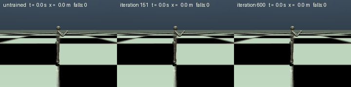

# Demo: a MuJoCo humanoid learns to walk — physics on the CPU, training on the Tenstorrent tray



**Video (15 s, real time, 1440x352 H.264, 1.3 MB): [`walk.mp4`](walk.mp4)** — the same three policies side by side, longer and larger than the GIF; the counters show the time, the distance run and the number of falls (untrained: 35 falls in 14 s; iteration 151: 11 m walked; iteration 600: 40 m run).

*Left: untrained policy (falls after ~27 steps, again and again). Middle: after 151 iterations (stands, walks at 0.8 m/s). Right: after 600 iterations (runs at 2.9 m/s, no fall in 256 test episodes).*

The environment is MuJoCo's humanoid on the **CPU** (4096 copies, stepped by MuJoCo's multithreaded `rollout`); the policy (actor + critic MLPs [512, 256, 128]) is trained by PPO on **one Blackhole chip**
through the unmodified upstream `OnPolicyRunner` and `rsl_rl_tt.ppo:TTPPO`. Same code path as the rest of this port: traced act / update / GAE, device-resident rollout storage, checkpoints in upstream format.

## Result (seed 0, one run)

| | TT, 1 chip (600 iterations) | upstream PPO on the CPU (150 iterations, same settings) |
|---|---|---|
| samples per iteration | 4096 envs x 24 steps = 98 304 | the same |
| time per iteration | **1.33 s** (CPU simulation 0.90 s + TT 0.43 s) | 3.73 s (CPU simulation 0.95 s + CPU PPO 2.78 s) |
| first iteration with mean episode length >= 990 (stands) | 121 (**2.7 min**) | 126 (7.8 min) |
| mean reward at iteration 150 / mean episode length | 567 / 1000 | 548 / 1000 |
| after 600 iterations (59 M samples, 13.3 min) | return 824, episode length 993 of 1000, **2.75 m/s**, 3 % of the episodes end in a fall | not run |

* The two runs learn the same way (same curve against the iteration; they are not bit-identical: Adam amplifies numerical noise, see `TOLERANCES.md`). What differs is the time: the algorithm part (rollout
  inference, GAE, PPO update) is 6.5x faster on the chip (0.43 s against 2.78 s per iteration).
* Deterministic evaluation of the checkpoints (256 episodes of up to 1000 steps, `walk.gif.json`): untrained: 27 steps to the first fall, 100 % falls; iteration 151: 1000 steps, 0.81 m/s, 0 % falls; iteration 600:
  1000 steps, 2.90 m/s, 0 % falls.
* Curves: `curves.png` (return, episode length, forward speed against the iteration; return against the wall-clock time). Logs: `tt_1chip/metrics.csv`, `cpu_150it/metrics.csv`, `*/summary.json`.
* **The CPU simulation is now the bottleneck on the TT side: 68 % of the 800 s.** More chips would shrink only the 32 % that is training; to go faster the environment has to move (Isaac Lab on a GPU through the bridge of
  Phase 7, `ISAAC_RUNBOOK.md`) or get more cores.

## What this is and is not

* One seed, one run per backend: a demonstration, not a benchmark. PPO on humanoid is seed-sensitive; the dips in the curve (iteration ~190) are real.
* The task is Gymnasium's `Humanoid-v5` (model, reward: 1.25 x forward velocity + 5 while healthy - 0.1 x |ctrl|^2, fall = torso height outside 1.0-2.0 m, 15 s episodes, 17 torque actuators) with the changes
  listed in `rsl_rl_tt/demos/mujoco_humanoid.py`: forward velocity of the root instead of the centre of mass, a 45-dimensional observation (qpos[2:], qvel), the reward scaled by 0.1 (rsl_rl has no reward
  normalisation and its clipped value loss moves the critic by at most 0.2 per update). The physics are identical to a plain `mj_step` loop (max |qpos difference| 5e-8 over 23 steps, tested).
* The reward has no style term: the gait is whatever maximises forward speed (arms flail, strides are long); it is a fast, stable run, not a human-looking walk. Isaac Lab's humanoid tasks add such terms.
* Rendering is MuJoCo's software EGL renderer; the floor is drawn larger than the model's (a plane collides everywhere anyway).

## Reproduce

```bash
source .venv/bin/activate                         # needs: pip install "gymnasium[mujoco]==1.4.0" (ENV.md)
# train on one chip (13 min); checkpoints model_<it>.pt land in .run/humanoid/tt_1chip (git-ignored)
scripts/tt_run.sh --chips 16 --timeout 7200 --tag humanoid -- python scripts/train_humanoid_demo.py --backend tt --envs 4096 --iterations 600 --out docs/porting/demo_humanoid/tt_1chip
# the CPU comparison (12 min, host only)
python scripts/train_humanoid_demo.py --backend cpu --envs 4096 --iterations 150 --threads 32 --out docs/porting/demo_humanoid/cpu_150it
# the video (real time, 15 s; needs imageio-ffmpeg, see ENV.md)
MUJOCO_GL=egl python scripts/render_humanoid_demo.py --checkpoints random .run/humanoid/tt_1chip/model_150.pt .run/humanoid/tt_1chip/model_599.pt --seconds 15 --fps 33 --size 352 480 --no-eval --video docs/porting/demo_humanoid/walk.mp4
# the GIF and the evaluation, then the curves
MUJOCO_GL=egl python scripts/render_humanoid_demo.py --checkpoints random .run/humanoid/tt_1chip/model_150.pt .run/humanoid/tt_1chip/model_599.pt --seconds 10 --fps 12 --size 180 240 --out docs/porting/demo_humanoid/walk.gif
python scripts/plot_humanoid_curves.py --run "TT, 1 chip=docs/porting/demo_humanoid/tt_1chip" --run "upstream PPO, CPU=docs/porting/demo_humanoid/cpu_150it" --out docs/porting/demo_humanoid/curves.png
```

Variants: `--mesh 2x4` (all eight chips, `--envs` a multiple of 256) trains the same task data parallel; the environment can also run on another host through the bridge (`rsl_rl_tt/bridge`, serve a
`MujocoHumanoidVecEnv` with `serve(env, endpoint, agent_cfg=...)`).
