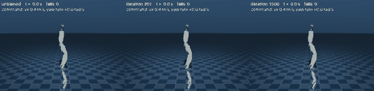

# Example: a Unitree G1 learns to walk on command (physics on the CPU, training on the Blackhole tray)



**Video (20 s, real time, 1440x608): [`g1.mp4`](../../docs/porting/demo_g1/g1.mp4)** — the same robot, the same commands (0.4 m/s, 0.8 m/s, then 0.5 m/s while turning left and right, 5 s each), three stages of one training run. Under each robot its **reward** (the return of its current episode, live, one scale for all three, red ticks = falls) and at the bottom the **training curve** of the run (mean episode return and speed against the iteration, the three iterations marked in the colour of their panel):

| | what it does |
|---|---|
| **initial** — iteration 1, untrained | falls forward after ~80 control steps (1.6 s), again and again (the counter in the picture); 100 % of its episodes end in a fall |
| **middle** — iteration 101 | keeps its balance (no fall) but does not move: 0.00-0.01 m/s whatever the command. The robot has learnt to stand; walking comes later |
| **final** — iteration 1500 | follows the commands without a fall: 0.39 m/s for 0.4, 0.78 m/s for 0.8, 0.51 m/s and 0.38 rad/s for (0.5, 0.4) |

The middle stage is iteration 101 and not the exact middle of the run (iteration 750) because from iteration ~250 on the gait no longer changes much: iteration 201 already follows the commands (0.76 m/s for 0.8) and
looks like the final one. Iteration 101 is the stage in between — standing, not yet walking. The numbers (256 robots x 12 s per command, deterministic policy) are in [`eval.json`](../../docs/porting/demo_g1/eval.json),
the whole run in [`docs/porting/demo_g1/`](../../docs/porting/demo_g1/README.md) (curves, timing, what had to be fixed to make the robot step).

## Run it

```bash
source .venv/bin/activate                         # needs gymnasium[mujoco] and imageio-ffmpeg (docs/porting/ENV.md)
scripts/fetch_g1_model.sh                         # once: the G1 model of MuJoCo Menagerie, pinned to one commit (38 MB, git-ignored)

# 1. train on all eight chips of the tray: 1500 iterations x 4096 robots x 24 steps = 147 M samples, 28 minutes
scripts/tt_run.sh --timeout 14400 --tag g1 -- python examples/g1_walk/train.py --mesh 2x4 --envs 4096 --iterations 1500
#    (one chip: --chips 16 ... --mesh 1x1, 1.35 s per iteration instead of 1.10 s;  upstream PPO on the CPU, no device: --backend cpu, 3.9 s per iteration)

# 2. watch it: evaluation of checkpoints and the video / GIF of the three stages (no device needed)
MUJOCO_GL=egl python examples/g1_walk/play.py \
    --checkpoint random .run/examples/g1_walk/model_100.pt .run/examples/g1_walk/model_1499.pt --video g1.mp4 --gif g1.gif
```

`train.py` writes a checkpoint every 100 iterations (`model_<iteration>.pt`, so `model_100.pt` is the state after 101 iterations) and `metrics.csv` to `.run/examples/g1_walk/` (git-ignored). The checkpoints are in the
upstream rsl_rl format: `OnPolicyRunner.load()` reads them, as do the JIT / ONNX exports of upstream.

## What is in the code

`train.py` is the whole training, in six lines that matter:

```python
env = MujocoG1VecEnv(4096)                                          # a rsl_rl VecEnv; MuJoCo's multithreaded rollout, 47 observations (+8 privileged for the critic), 12 leg joints
cfg = g1_train_cfg(num_steps=24, save_interval=100)                 # a rsl_rl 5.x config: actor / critic MLP [512, 256, 128], PPO, empirical observation normalisation
cfg = tt_agent_cfg(cfg, mesh_shape=(2, 4), trace=True)              # the only TT-specific line: the algorithm becomes rsl_rl_tt.ppo:TTPPO, on a 2x4 mesh, traced
runner = OnPolicyRunner(env, cfg, log_dir=log_dir, device="cpu")   # the unmodified upstream runner
runner.learn(num_learning_iterations=1500, init_at_random_ep_len=True)
```

* **The task** is written for this demo and documented term by term in `rsl_rl_tt/demos/mujoco_g1.py` (velocity tracking, posture, foot height following a gait phase, alternating contacts, penalties); the training
  config is `rsl_rl_tt/demos/g1_cfg.py`; the evaluation and rendering used by `play.py` is `rsl_rl_tt/demos/g1_render.py`.
* **Eight chips** = data parallel: each chip holds 512 of the 4096 robots' samples, gradients are averaged over the chips, the parameters stay replicated (checked). The CPU simulation is 76 % of an iteration, so the
  chips cut the time of an iteration only from 1.35 s (one chip) to 1.10 s; see the table in [`docs/porting/demo_g1/README.md`](../../docs/porting/demo_g1/README.md).
* Simulation only: no domain randomisation, pushes or observation noise; one seed. A demonstration of the training path, not a benchmark and not a policy for the real robot.
